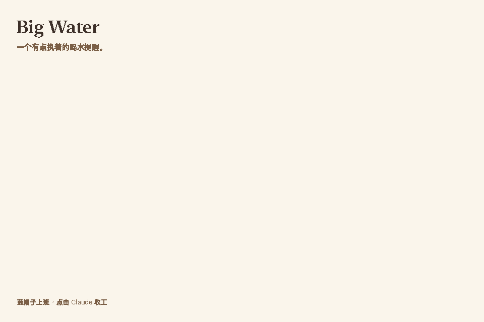
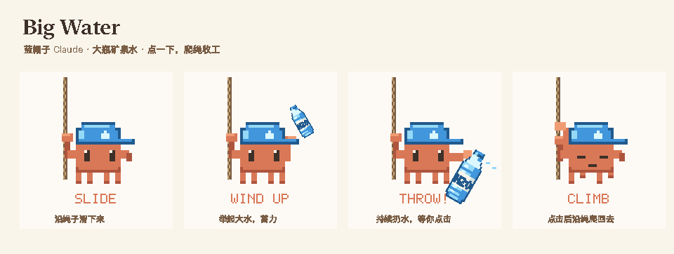

# Big Water · 大水

一个 macOS 菜单栏喝水提醒。到点时，一个像素小人顺着绳子从屏幕顶上滑下来，一直朝你扔矿泉水，直到你去喝水。

*A pixel-art water reminder for the macOS menu bar. The interface is in Chinese.*

<p align="center">
  
</p>

- **提醒难以忽视，又不打断你**：它不会抢走键盘焦点，你正在打的字不会被打断；屏幕上只有角色、对话气泡、按钮和卡片接收点击，其他地方照常可以点到下面的窗口。
- **只在你真正用电脑时计时**：休眠、显示器熄屏或切换到其他用户时自动暂停，回来后接着剩余时间继续。
- **按你的作息工作**：默认只在每天 06:00–22:00 提醒，可以单独设置周末。
- **记录保存在本机**：没有账号，也没有统计和遥测。联网只用于检查和下载更新。
- **一键更新**：每天自动检查新版本，确认后直接下载、安装并重新打开。

## 安装

**要求**：macOS 13 或更高版本，支持 Apple 芯片和 Intel 芯片。

### 下载安装

从 [最新 Release](https://github.com/SORMaker/BigWater/releases/latest) 下载 `BigWater-版本号.zip`，解压后将 `Big Water.app` 拖进“应用程序”文件夹，再双击打开。

发布包使用免费的本地代码签名及 Sparkle 更新签名，尚未经过 Apple Developer ID 签名和公证。首次打开下载的 App 时，macOS 可能要求你在“系统设置 → 隐私与安全性”里确认打开。

### 从源码构建

需要 Xcode 命令行工具，构建时会自动匹配你的电脑。

1. 如果还没装过命令行工具：

   ```sh
   xcode-select --install
   ```

2. 下载源码并构建：

   ```sh
   git clone https://github.com/SORMaker/BigWater.git
   cd BigWater
   ./Tools/build.sh
   ```

3. 把生成的 `dist/Big Water.app` 拖进“应用程序”文件夹，然后双击打开。

打开后，菜单栏会出现一个蓝色的像素水瓶，Dock 里不会有图标。点击水瓶即可打开设置。

> 自己构建的 App 不会被 macOS 拦截，所以不需要去“隐私与安全性”里放行。

**登录时启动**默认开启，第一次打开时就会注册。不想要可以在设置面板底部关掉。如果你把 App 换了位置，请在设置里把这个开关关掉再打开一次。

### 更新

设置面板底部提供“自动检查更新”和“检查更新…”：

- 默认每天自动检查一次，可随时关闭；关闭后仍可以手动检查。
- 发现新版本时，菜单栏水瓶旁会显示提示点，设置中也会显示新版本号；点击“查看更新…”可阅读说明、下载并安装，App 会自动退出、替换并重新打开。
- 默认不会静默安装或突然重启。设置、倒计时和喝水记录会保留。
- `0.3.0` 及更早版本尚无更新器，需要先手动安装一次 `0.4.0` 或更高版本。

如果仍想自己编译更新：

```sh
cd BigWater
git pull
./Tools/build.sh
```

先在菜单里退出 Big Water，再用新的 `dist/Big Water.app` 替换“应用程序”里的旧版本。倒计时、设置和喝水记录都会保留。

### 卸载

1. 在设置面板里关掉“登录时启动”，然后点“退出 Big Water”。
2. 删除“应用程序”里的 `Big Water.app`。
3. 如果也想删掉设置和喝水记录：

   ```sh
   defaults delete com.oil.bigwater
   ```

## 怎么用

到了提醒时间，小人会从鼠标所在的那块屏幕顶部滑下来，旁边出现三个按钮：

| 操作 | 效果 |
| --- | --- |
| **我刚喝过水** | 记一次喝水，重新开始完整的间隔，小人挥手后爬回去 |
| **10 分钟后 / 20 分钟后** | 暂时收起，过一会儿再提醒；不改变你设置的间隔 |
| **点小人本身** | 记一次喝水，收起提醒并重新计时 |

同一次提醒只记录一次。

同样的三个按钮也会出现在菜单栏面板里，用键盘或者提醒在另一块屏幕上时也能操作。

<p align="center">
  
</p>

### 设置面板

| 设置 | 说明 |
| --- | --- |
| 倒计时 | 实时显示距离下次提醒还有多久，以及今天确认了几次 |
| 提醒间隔 | 0.5–24 小时，每次调整半小时，默认 2 小时。调整时会保留已经计入的时间 |
| 暂停 30 / 60 分钟 | 开会或专注时用；保留剩余进度，到点自动恢复，也可以提前恢复 |
| 提醒方式 | **角色动画**，或者右下角一张安静的**轻量卡片**；可选提示音（默认关闭） |
| 作息时间 | 每天的开始和结束时间，可为周末单独设置；结束时间设为 00:00 表示当天 24:00 |
| 角色与外观 | 角色可选 Claude 或水滴，配色可选海蓝、薄荷、蜜桃；“预览当前效果”不会影响计时和记录 |
| 今日记录 | 今天每次点小人或“我刚喝过水”确认喝水的时间 |

## 计时规则

Big Water 计的是你**实际使用电脑的时间**，不是钟表上过去了多久：

- **暂停**：系统休眠、显示器熄屏、切换到其他用户时停止计时，恢复后接着剩余时间继续。例如间隔为 2 小时、已经计了 45 分钟，电脑休眠 3 小时，醒来后还剩 75 分钟。仅锁屏而显示器仍亮着时，会继续计时。
- **作息时间外不计时**：结束时间一到，正在显示的提醒会收起；第二天作息开始后、你开始使用电脑时，从完整的间隔重新开始，不会在早上补发昨晚的提醒。
- **不够一个间隔就不提醒**：如果今天剩下的作息时间不够一个间隔，今天就不再提醒。
- **重新计时**：从你点按钮（或点小人）的那一刻开始。
- **退出再打开**：当天再次打开时，倒计时、暂停和稍后提醒都会恢复，App 没运行的时间不计入；如果期间改了间隔或作息，或者已经过了一天，就从完整的间隔开始。正常退出时保存；计时中每 30 秒也会保存一次，意外退出最多损失 30 秒。
- **改系统时间不影响倒计时**：计时用的是系统内部的单调时钟。时区和夏令时变化会自动跟随。

## 隐私

- 仅为检查版本、获取更新说明和下载更新包访问 GitHub 及其下载服务，没有统计和遥测。
- 自动检查更新可关闭；手动检查仍会联网。喝水记录和提醒设置不会上传。
- 只记录你点小人或“我刚喝过水”确认喝水的时间，不估算喝水量，只保留最近 90 天。
- 所有数据都保存在本机的偏好设置 `com.oil.bigwater` 中。卸载方法见上文。

## 开发

```sh
swift run BigWaterChecks      # 核心检查：计时、存档、动画与绘制
./Tools/check-session.sh      # 会话检查：驱动真实的 App 类
./Tools/run.sh --preview      # 构建、启动并立即弹出一次真实提醒
```

- 会话检查会在桌面上短暂弹出提醒窗口，需要亮屏的桌面会话。它不会让电脑真的休眠，也不会修改系统时间。
- `--preview` 会在作息时间内提前弹出一次真实提醒，点小人或“我刚喝过水”都会被记录。运行前请先退出正在运行的 Big Water。
- 只需要 Xcode 命令行工具，不依赖 XCTest。更新器使用 [Sparkle 2](https://sparkle-project.org/)，由 Swift Package Manager 下载固定版本。

### 发布更新

`Resources/Info.plist` 中的版本号和构建号必须一起递增。先提交代码和发布说明，再准备可发布的安装包。更新包与更新源使用 Ed25519 签名；私钥保存在发布者本机的登录钥匙串中，仓库仅保存公钥。

本机第一次配置签名工具（只需一次，已存在的密钥会复用）：

```sh
swift package resolve
.build/artifacts/sparkle/Sparkle/bin/generate_keys --account com.oil.bigwater.sparkle
```

确认输出的公钥与 `Resources/Info.plist` 中的 `SUPublicEDKey` 一致。新发布者需安全迁移原有私钥，不能随意生成不同密钥替代。

```sh
./Tools/release.sh --notes-file docs/releases/0.4.0.md
```

这会构建同时支持 Apple 芯片和 Intel 的 App，生成签名更新包及 `appcast.xml`，默认仅保存在 `dist/releases/`。检查后，在同一条命令后加上 `--publish`，即可验证并发布已准备的安装包。源码有变化的包不能直接发布；原有输出会保留。未提交的源码或未提供发布说明时，产物只会进入独立的 `dist/previews/` 目录，供本机测试。App 通过最新 Release 的 `appcast.xml` 获取更新；源码和编译检查不会启动更新器。

Sparkle 及所含组件的许可见 [Resources/Sparkle-LICENSE](Resources/Sparkle-LICENSE)。

| 目录 | 内容 |
| --- | --- |
| `Sources/BigWaterCore` | 计时规则、设置、喝水记录、动画状态；不依赖 AppKit 界面 |
| `Sources/BigWaterArt` | 像素角色、水瓶、配色和场景绘制 |
| `Sources/BigWaterApp` | 菜单栏、设置面板、存档和透明的提醒窗口 |
| `Sources/BigWater` | 启动 App 的入口 |
| `Sources/BigWaterArtwork` | 用同一套绘制代码生成图标、分镜图和 GIF |
| `Tests/` | 核心检查和会话检查 |

`REVIEW.md` 是一份代码审查记录，`VERIFICATION.md` 是各版本的验证记录。

## 已知限制

- 真实的系统休眠和唤醒目前只用模拟通知验证过，还没有在实机上完整测试。
- `REVIEW.md` 中 V1–V3 三项还需要在实机上确认：直接键入作息时间、角色边缘偶尔闪一帧橙色、在系统设置里关掉登录项后开关的显示。

## 许可

[MIT](LICENSE)。

## 说明

这是一个个人的非官方项目，与 Anthropic 没有关联，也未经其认可。“Claude”是 Anthropic 的商标。
